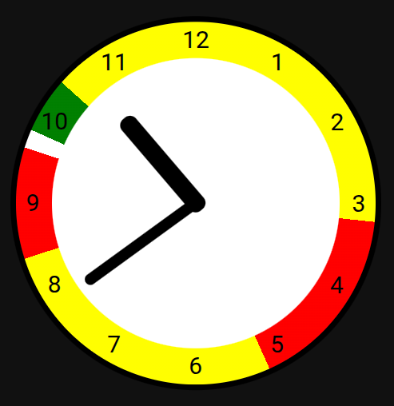

[](https://buymeacoffee.com/klurige)

# Level Indicator Clock
[](https://github.com/hacs/integration)
[](https://github.com/Klurige/levelindicatorclock/releases)
[](https://github.com/Klurige/levelindicatorclock/issues)

This card shows an analogue clock that presents current time and electricity price level for the next twelve hours.

It is tightly coupled with the **[energyadvisor](https://github.com/Klurige/energyadvisor)** integration.



The outer circle shows red for high, yellow for medium and green for low electricity price levels.

There is also a white delimiter marking the breakpoint between the past and the future.

## Level colours

The sensor's compact levels use the following uppercase symbols. Past levels are displayed in darker shades.

| Symbol | Colour | RGB | Meaning |
|--------|--------|-----|---------|
| `A` | Azure | `#0080ff` | Minutes indicator |
| `B` | Teal | `#00665e` | Battery standby |
| `C` | Cyan | `#00d9ff` | Battery charging |
| `D` | Raspberry | `#c2185b` | Battery discharging |
| `E` | Magenta | `#ff00ff` | Error |
| `F` | Turquoise | `#00a88f` | Battery PV charging |
| `H` | Red | `#ff0000` | High electricity price |
| `I` | Amber | `#ffb000` | Seconds indicator |
| `L` | Green | `#00c853` | Low electricity price |
| `M` | Yellow | `#ffd600` | Medium electricity price |
| `O` | Black | `#000000` | Off |
| `P` | White | `#ffffff` | Current-time marker |
| `S` | Blue | `#0066ff` | Solar electricity price |
| `T` | Medium purple | `#9370db` | Battery selling |
| `U` | Grey | `#808080` | Unknown or missing level |
| `V` | Violet | `#8000ff` | Hours indicator |
| `X` | Orange | `#ff8c00` | Battery maxuse |

## Prerequisites
This card is tightly coupled with the **[energyadvisor](https://github.com/Klurige/energyadvisor)** integration.
Install that integration, including its dependencies, first. Also make sure that the diagnostic entity "Compact Levels" is enabled.

## Installation
### HACS (Home Assistant Community Store)
1. Go to HACS -> Frontend -> and click the 3-dots in the top right and select "Custom Repositories".
2. Add the URL to this repository in the "Repository" field, select the "Lovelace" category, and click "ADD".
3. The `Level Indicator Clock` card will now be available in HACS. Click on it and proceed with the installation.
4. Restart Home Assistant.

### Manual Installation
1. Download the `LevelIndicatorClock.js` file from the [latest release](https://github.com/Klurige/levelindicatorclock/releases).
2. Place the file in your `config/www` folder.
3. Add the following to your `ui-lovelace.yaml` or via the UI under `Configuration` -> `Lovelace Dashboards` -> `Resources`:
   ```yaml
   resources:
     - url: /local/LevelIndicatorClock.js
       type: module
   ```
4. Restart Home Assistant.

## Configuration
Add the card to your Lovelace dashboard:
```yaml
type: custom:level-indicator-clock
compact_levels: sensor.electricitypricelevels
show_legend: true
```

| Name | Type | Default | Description |
|------|------|---------|-------------|
| type | string | **required** | `custom:level-indicator-clock` |
| compact_levels | string | **required** | The compact levels sensor from the `energyadvisor` integration. |
| show_legend | boolean | `false` | Show the colour legend below the clock. |

The legend groups price or battery modes separately from common colours. A sensor
whose entity ID contains `battery` (case-insensitive) is treated as a battery
mode sensor; other sensors are treated as price sensors. Battery mode symbols
are translated to the battery colours listed above: `S` → `B`, `P` → `F`,
`E` → `T`, and `M` → `X`; `C` and `D` stay unchanged. Choose an entity ID
containing `battery` when renaming the battery sensor.

## Development
### Setup
Follow these tutorials to setup your environment: 
  * Setup a devcontainer: https://github.com/home-assistant-tutorials/01.development-environment
  * Install HACS: https://github.com/home-assistant-tutorials/07.toggle-card-to-hacs

Once you've got your devcontainer running, you should install the dependencies as above.

Clone this repository: `git clone https://github.com/Klurige/levelindicatorclock.git`

Modify the `.devcontainers/devcontainer.json` file and include a mount :
```
{
"name": "Home Assistant Dev",
"mounts": [
"source=<PATH/TO/GIT/levelindicatorclock/dist,target=/workspaces/home-assistant-core/config/www/levelindicatorclock,type=bind,consistency=cached"
],
...
}
```
Rebuild the devcontainer and restart it.

Go to Settings -> Dashboards and click on the kebab icon in the top right corner to add resources.
Add the following resource:
```
local/levelindicatorclock/LevelIndicatorClock.js
```

You can now add the card to your dashboard as usual.

### Development
To continuously build the card when you make changes to the source code, run the following command in the terminal:
```bash
npm run watch
```
or
```bash
npx parcel src/index.ts
```

This will rebuild the card whenever you make changes to the source code. (In Webstorm ide, you must click inside the terminal window to give it focus before it will pick up changes.)

To update the card in the browser, you will need to hard-refresh the browser.
For Google Chrome: Open the Inspect window and press: `Ctrl+Shift+R`.
Other browsers may have different shortcuts.

## Running Unit Tests

Unit tests are written using [Jest](https://jestjs.io/).

```bash
npm test
```

## Code Quality

### Naming Conventions Audit

This project follows strict naming conventions for consistency and maintainability. You can run an automated audit to check compliance:

```bash
npm run audit:naming
```

The audit checks for:
- ✅ Variables use `camelCase`
- ✅ Constants use `UPPER_SNAKE_CASE`
- ✅ Classes/Interfaces use `PascalCase`
- ✅ Methods use `camelCase` (no underscore prefixes)
- ✅ CSS selectors use `kebab-case`

The tool will report any naming issues with file locations and provide a score out of 100.

For detailed naming conventions, see [NAMING_CONVENTIONS.md](NAMING_CONVENTIONS.md).

## License
This project is licensed under the GNU General Public License (GPL). See the [LICENSE](LICENSE) file for details.

## Say Thanks
If you like this project, please consider supporting me.

[](https://buymeacoffee.com/klurige)
